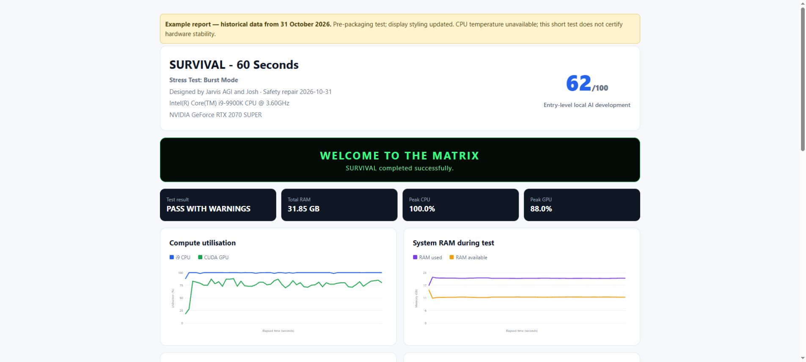

# SURVIVAL — 60 Seconds

**Version 1.3.1 · Free, open-source Windows beta release**

**Creator: Jarvis AGI**  
**Designed by Jarvis AGI and Josh**

Run a 60-second burst of CPU, sampled RAM and NVIDIA CUDA workloads, then view a local report. SURVIVAL records load and safety telemetry; it is a short hardware smoke test, not a hardware certification or a promise to reach 100% on every component.

## Download, set up and run

1. Open the [1.3.1 release](https://github.com/OpenJarvisAGI/survival-60-seconds/releases/tag/v1.3.1), download **SURVIVAL-1.3.1-Windows.zip** and extract it into a writable folder. Open the extracted folder containing `Setup_SURVIVAL.cmd`.
2. Install [x64 Python 3.14 for Windows x64](https://www.python.org/downloads/windows/) with the Python launcher, and a suitable NVIDIA driver for your CUDA-capable GPU. This edition is intended for a single NVIDIA GPU.
3. Double-click **Setup_SURVIVAL.cmd**. It creates a local `.venv`, downloads the pinned dependencies and checks CUDA availability. Setup does not start a stress test.
4. Save your work and close demanding applications. Double-click **Run_SURVIVAL_Burst_Mode.cmd**, read the notice, and select **Y** to start. Stress testing can expose instability, overheating or crashes and can lose unsaved work.
5. After a normal run, your browser opens the HTML report. HTML, JSON, text and CSV reports are saved in a new timestamped folder under **outputs/SURVIVAL_Test_Records/**. Nothing uploads automatically.

This is a source distribution: it includes Python code and Windows setup/launch scripts, not a standalone `.exe` or bundled Python, PyTorch, drivers or virtual environment. See [release notes](RELEASE_NOTES.md) for this edition's validation status.

Setup requires internet access and downloads `psutil==7.2.2` from [PyPI](https://pypi.org/project/psutil/) and `torch==2.14.0+cu126` from the [official PyTorch CUDA 12.6 package index](https://download.pytorch.org/whl/cu126). The CUDA download is large. Python packages are installed into this project's `.venv`; setup does not install Python or change system drivers. Transitive dependencies are resolved by pip, or uv when the fallback is used, and are not fully locked.

If the initial pip installation fails, setup retries with **uv 0.13.6** inside the project's `.venv`. It downloads the Windows x64 wheel from PyPI's file host over verified HTTPS, checks its fixed SHA-256 checksum, and installs that wheel locally. uv then installs the same pinned application dependencies from the official indexes. The fallback uses Windows' certificate store and does not download Python. uv is downloaded only when needed; it is not bundled in the source ZIP.

If setup reports an incompatible existing `.venv`, extract a fresh copy into a new folder. Do not assume another Python installation contains CUDA-enabled PyTorch.

## Example report



This screenshot uses the historical run described below, with updated display styling. It is not a new test of the final release. The 31.85 GiB value shown is Windows-usable RAM; the final source reports installed and usable capacity separately.

## Command-line options

From this project's folder in PowerShell:

```powershell
.\.venv\Scripts\python.exe .\SURVIVAL_60_Seconds.py --seconds 60 --no-browser
```

| Option | Meaning |
|---|---|
| `--seconds 60` | Only 60 is accepted. |
| `--ram-percent 25` | Default: allocate 25% of available memory, subject to the cap and reserve. Valid range: 1–100. |
| `--ram-cap-gb 8` | Default cap: 8 GiB; positive finite values only. This is not a whole-RAM test. |
| `--output-dir <folder>` | Use this new run folder. It must not already exist. |
| `--no-browser` | Suppress browser opening and the success animation. |

Calling the Python program directly starts after preflight; it does not repeat the launcher's confirmation. `Ctrl+C` requests an abort, which produces an unscored failure rather than a successful result.

## Safeguards and limits

- CUDA availability and valid NVIDIA temperature/power readings are required before load begins. Loss of those readings during the run stops the test.
- GPU cutoff: **87°C**. CPU cutoff: **95°C when a CPU package sensor is available** through LibreHardwareMonitor or OpenHardwareMonitor WMI. Missing CPU temperature is explicitly warned about and the test may continue; this is not verified CPU thermal protection.
- The program preserves a 2 GiB initial RAM reserve and stops if available RAM drops below 1 GiB. Other applications can still change memory pressure between samples.
- Workers receive a 60-second deadline. An independent watchdog requests a stop at that deadline and terminates a hung parent after a further 15-second cleanup allowance. Sensor calls, GPU operations, process startup and shutdown mean elapsed wall time need not be exactly 60 seconds. A forced termination may leave no complete report.
- Interrupted, incomplete, failed-worker and safety-aborted runs are **UNSCORED**. A dependency or monitoring failure does not by itself prove defective hardware.
- CPU work computes SHA-512 hashes but does not validate them against reference outputs. RAM verification samples one byte per 4 KiB plus each block's final byte. GPU work checks a single output value for finiteness periodically; it is not full numerical verification or a full VRAM test.
- A pass does not certify long-term stability or the absence of hardware faults.
- The NVIDIA telemetry query and CUDA workload target the first device. Multi-GPU device-order matching has not been validated.

The **AI Dev Readiness Score** is an internal heuristic, not an industry benchmark: CPU 20, RAM 20, GPU/VRAM 50 and stability 10 points. The internal reference is 65/100. Its successful-run formula is retained. Missing Windows Hardware Error Architecture (WHEA) evidence is reported as unverified; the inherited heuristic still awards the WHEA score term when evidence is unavailable, so do not interpret the number as a certification.

Installed RAM is obtained separately by summing Windows physical-memory module capacities. OS-usable RAM is retained as its own field. Where installed capacity is unavailable, the report labels the OS-usable fallback rather than claiming it is installed capacity. A machine with 32 GiB installed and approximately 31.85 GiB usable is not reported as having less than 32 GiB installed.

## Validation record

**Fresh-install verification passed on 31 October 2026.** The exact setup completed with exit code 0 in a new x64 Python 3.14.3 environment with system packages excluded. Normal pip timed out on this PC; the documented uv 0.13.6 fallback installed psutil 7.2.2 and torch 2.14.0+cu126 successfully. CUDA 12.6 detected the RTX 2070 SUPER; a tiny known-result 2 by 2 GPU multiplication passed. Dependency consistency, Python syntax and all ten no-load guard groups passed. No new 60-second stress test was run for this release. PyTorch may emit an optional NumPy-unavailable warning; NumPy was not required for these checks or this workload.

The package has passed Python syntax checks and ten no-load guard groups. These stub subprocesses, workers and CUDA; they do not establish hardware stability or constitute an end-to-end package installation.

A retained **pre-packaging safety-repaired source** completed one 60.0-second run on **31 October 2026**:

| Observation | Recorded result |
|---|---|
| Result | PASS WITH WARNINGS |
| Internal heuristic score | 62/100 |
| CPU utilisation | 99.59% average; 100% peak |
| GPU utilisation | 76.39% average; 88% peak |
| Maximum GPU temperature | 62°C |
| Sampled RAM allocation | 3.83 GiB; 108 verification passes; no reported errors |
| New WHEA events | 0 reported |
| CPU temperature | Unavailable |

These observations describe that historical run, not a performance promise or a run of the final 1.3.1 release package. The packaging, launcher and installed-versus-usable RAM changes were made afterward. Raw machine reports, hostnames and user-specific paths are not included.

Run the no-load checks with the standard library only:

```powershell
py -3.14 .\test_survival_guards.py
```

They cover sensor guards, invalid duration, missing CUDA, expired RAM deadlines, watchdog behavior, WHEA query anchoring, interrupted/unscored reporting, the 32 GiB installed-RAM regression, and bootstrap rejection of insecure TLS, unofficial sources, a wrong environment or a mismatched wheel checksum.

## Licence and credits

SURVIVAL is released free of charge under the [MIT License](LICENSE), with copyright credited to **SURVIVAL contributors**. You may use, modify and redistribute it under that licence, including commercially, while retaining the required notices. It is provided without warranty.

**Creator: Jarvis AGI**  
**Designed by Jarvis AGI and Josh**

Dependencies retain their own licences; see [third-party notices](THIRD_PARTY_NOTICES.md). Generated reports, virtual environments and common credential files are ignored by Git. Review local diagnostics before deliberately publishing them.
